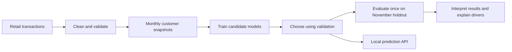
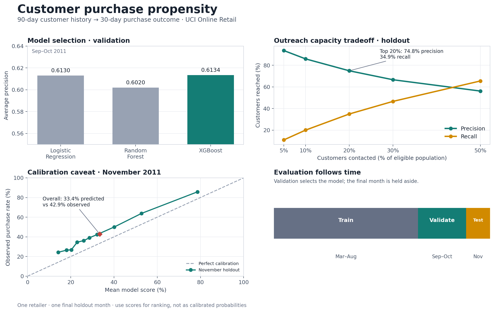

# Customer Purchase Propensity

An end-to-end machine learning portfolio project: use historical retail transactions to rank active customers by their likelihood of purchasing again in the next 30 days.

## Project at a glance

- **Dataset:** UCI Online Retail, 541,909 invoice lines from December 2010 to December 2011.
- **Prediction:** for each monthly cutoff, use the previous 90 days of activity to predict a purchase in the next 30 days.
- **Population:** customers with at least one valid purchase in the 90-day observation window.
- **Models:** Logistic Regression, Random Forest, and XGBoost (with a scikit-learn boosting fallback if XGBoost's native runtime is unavailable).
- **Validation:** chronological train/validation/test periods; model selection uses validation average precision.
- **Best validation model:** XGBoost, average precision 0.6134.
- **Final historical holdout:** November 2011, average precision 0.6754 and precision 0.7485 in the top-ranked 20% of customers.

This is a portfolio demonstration on a small, single-retailer historical dataset. It shows an end-to-end workflow and engineering choices; it is not evidence of performance on future customers or a deployed marketing system.

## How the workflow fits together



The November holdout is kept separate from model selection. The model is refit on the training plus validation periods before its final holdout evaluation.

## Key result and interpretation

| Model | Validation average precision | Validation precision at top 20% |
|---|---:|---:|
| Logistic Regression | 0.6130 | 0.669 | 
| Random Forest | 0.6020 | 0.675 | 
| **XGBoost** | **0.6134** | 0.665 | 

On the November holdout, the model achieved **0.6754 average precision**. Contacting the top-ranked 20% would have reached 493 of 2,461 eligible customers, with **74.8% precision** and **34.9% recall** for that month.

The scores are **under-calibrated**: the average predicted score was 0.3336 while the observed purchase rate was 0.4291. Treat the output as a ranking score, not a reliable real-world purchase probability. The holdout is one month, and the purchase rate increased going into November, so this result should not be generalized without more time periods.

Feature analysis found order count to be the strongest model driver. This is an association learned from historical behavior, not evidence that increasing order count would cause another purchase.



Rebuild this graphic after reproducing the workflow with `python scripts/build_showcase_figure.py`.

More detail: [model comparison](docs/initial-model-results.md), [evaluation and explainability](docs/evaluation-and-explainability.md), and [label and split design](docs/data-and-validation-design.md).

## Run it locally

### 1. Set up Python

The documented model results were generated with Python 3.9.6 and the direct dependency versions in `requirements-demo.txt`. From the project root:

```bash
python3.9 -m venv .venv
source .venv/bin/activate
python -m pip install --upgrade pip
python -m pip install -r requirements-demo.txt
```

### 2. Add the source data

Download **Online Retail.xlsx** from the [UCI Machine Learning Repository](https://archive.ics.uci.edu/dataset/352/online-retail). The raw dataset is excluded from Git. Put the workbook at:

```text
data/raw/online_retail.xlsx
```

The project does not commit customer transaction data or generated model artifacts.

### 3. Run the project demo

```bash
bash scripts/run_demo.sh
```

The script rebuilds snapshots, trains and compares the models, evaluates the November holdout, runs the feature drift check, and refreshes the results graphic. It can take a few minutes. Generated snapshots and model/evaluation outputs are written under ignored `data/processed/` and `artifacts/` folders. MLflow runs are stored locally in `mlruns/`.

To run the unit suite separately, use `python -m pytest -q`.

XGBoost needs a native OpenMP runtime on some systems. If it cannot load, training reports the scikit-learn boosting fallback; expect model results to differ from the XGBoost metrics above. The pinned file versions direct dependencies, while pip may resolve transitive dependencies differently across platforms.

### 4. Try the app

The Streamlit app presents the historical business result, what it could mean for outreach, and the recommended controlled campaign follow-up. It does not ask stakeholders to enter an isolated customer profile, since an individual score is hard to interpret without a customer list to compare against:

```bash
python -m pip install -r requirements-app.txt
bash scripts/run_app.sh
```

Open `http://127.0.0.1:8501` if it does not open automatically. Press `Ctrl+C` in the terminal to stop the app. The results page can be viewed without starting the prediction API. The API remains available separately for technical demonstrations; see the next section.

### 5. Try the API directly (optional)

After training:

```bash
uvicorn src.api:app --reload
```

Open `http://127.0.0.1:8000/docs` to try a prediction. The API is a local demonstration; see [the API guide](docs/api.md).


## Project map

- `src/data_processing.py` — transaction validation and cleaning
- `src/feature_engineering.py` — point-in-time customer features and forward labels
- `src/prepare_data.py` — create monthly customer snapshots
- `src/train.py` — chronological model comparison, metrics, MLflow logging, and model manifest
- `src/evaluate.py` — holdout calibration, campaign-capacity analysis, and SHAP explanations
- `src/monitoring.py` — feature-distribution drift check
- `src/api.py` — local FastAPI prediction demo
- `src/model_registry.py` — local candidate promotion and rollback demonstration
- `scripts/run_demo.sh` — one-command walkthrough of the full local workflow
- `scripts/build_showcase_figure.py` — regenerate the README results graphic
- `requirements-demo.txt` — direct dependency versions used for the reported local run
- `tests/` — unit tests for data processing, features, monitoring, and API behavior
- `docs/` — design decisions, results, API notes, and maintenance guide

## Engineering notes

The repo also includes CI, a Dockerfile, local MLflow tracking, PSI monitoring, model provenance, and a local promote/rollback mechanism. These demonstrate useful engineering practices but are secondary to the modeling story. They are not a production deployment or durable model registry. See the [engineering guide](docs/engineering-guide.md) and [maintenance runbook](docs/maintenance-runbook.md).
